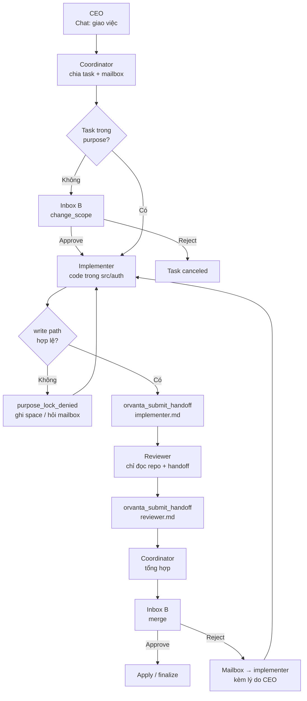
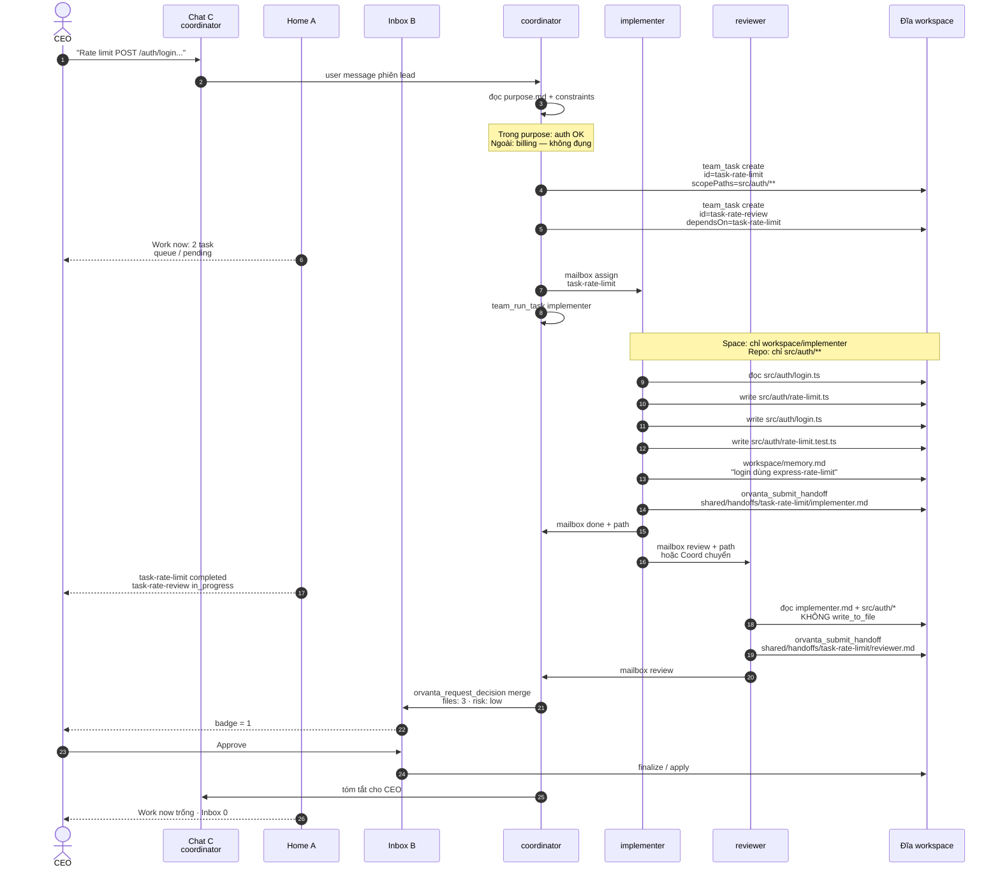
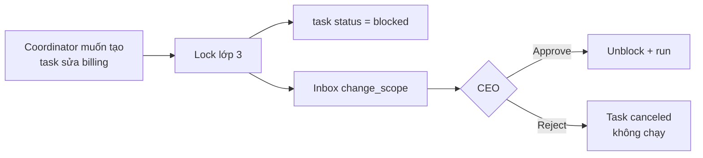
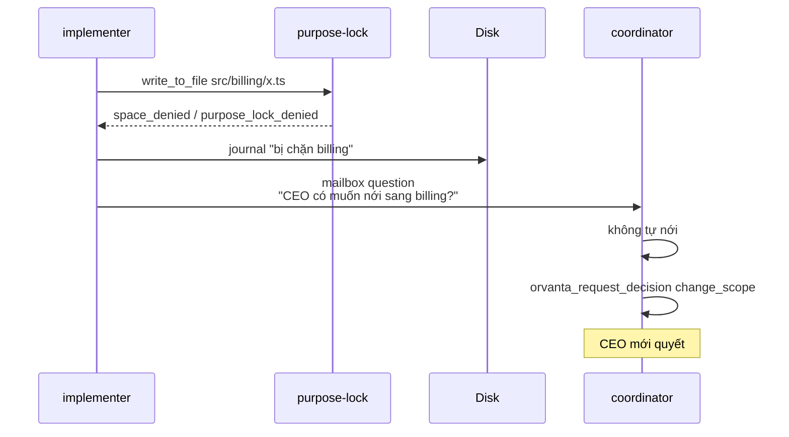
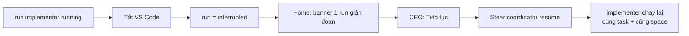

# Luồng: CEO giao việc coding

Ví dụ cụ thể — không trừu tượng.

**Purpose công ty (đã có):** “Xây auth cho app: login, session, không đụng billing.”

**CEO nói trên Chat (tab C, focus coordinator):**

> Thêm rate limit cho `POST /auth/login` trong `src/auth`. 5 lần / phút / IP. Có test. Đừng đụng billing.

Đội: `coordinator` · `implementer` · `reviewer`. Policy merge = `ceo_approve`. Session teams đang live.

---

## 0. Bức tranh một việc



CEO **không** ở trong vòng implementer ↔ reviewer, trừ khi Inbox có `change_scope` hoặc `merge`.

---

## 1. Sequence — đường hạnh phúc



---

## 2. Từng bước — ai làm, tool nào, đĩa nào

### Bước 1 — CEO giao (30 giây)

| | |
|---|---|
| Ở đâu | Tab **Chat**, chip “Nói với Coordinator” |
| CEO gõ | Việc + ràng buộc (“đừng đụng billing”) |
| Không làm | Không mở War room, không hire, không sửa profile |
| Home sau tin | Chưa đổi (chưa có task) |

### Bước 2 — Coordinator hiểu purpose

1. Đọc `purpose.md` (đã inject prompt).
2. So: “rate limit login” ∈ auth → **trong**. “đụng billing” bị CEO cấm sẵn.
3. Nếu tự bịa task `src/billing/**` → **dừng**, xem nhánh §4.

### Bước 3 — Chia việc (`team_task`)

| Task | Assignee | Status lúc tạo | Phụ thuộc |
|---|---|---|---|
| `task-rate-limit` — implement rate limit + test | implementer | `pending` → `in_progress` khi run | — |
| `task-rate-review` — review diff auth | reviewer | `pending` (`isReady=false`) | `task-rate-limit` |

`scopePaths` trên task implement: `src/auth/**`.  
Home **Work now**: 1 in progress, 1 queue “chờ 1”.

Mailbox `assign` → implementer (kind=`assign`, `taskId`).

### Bước 4 — Implementer chạy

`team_run_task` → run `running`. Sidebar / War room (1 cột): card implementer Violet.

**Được ghi**

```
src/auth/rate-limit.ts          ← repo scope
src/auth/login.ts
src/auth/rate-limit.test.ts
.orvanta/org/agents/implementer/workspace/memory.md
.orvanta/org/agents/implementer/workspace/scratch/plan.md
```

**Bị chặn** (`purpose_lock_denied`)

| Thử | Lý do |
|---|---|
| `src/billing/invoice.ts` | Ngoài `task.scopePaths` |
| `.orvanta/purpose.md` | Identity công ty |
| `.orvanta/org/agents/implementer/profile.md` | Identity mình |
| `.orvanta/org/agents/reviewer/workspace/**` | Space người khác |
| `shared/handoffs/...` bằng `write_to_file` | Phải dùng `orvanta_submit_handoff` |

Bị chặn: implementer ghi `workspace/journal/` hoặc mailbox `question` → coordinator. **Không** hỏi CEO từng file.

### Bước 5 — Nộp bài

```
orvanta_submit_handoff({
  taskId: "task-rate-limit",
  content: "## Files\n- src/auth/rate-limit.ts\n- ...\n## Test\nbun test src/auth/rate-limit.test.ts\n"
})
```

Host ghi **đúng**:

```
.orvanta/shared/handoffs/task-rate-limit/implementer.md
```

Không tạo `reviewer.md` giúp. Mailbox `done` → coordinator, path trong body.

Task `task-rate-limit` → `completed`. `task-rate-review` → `isReady=true`.

### Bước 6 — Reviewer

Coordinator `team_run_task` reviewer (hoặc reviewer nhận mailbox `review`).

Reviewer:

- `read_files` handoff + `src/auth/**`
- Không `write_to_file`, không `apply_diff`, không `execute_command` (default)
- `orvanta_submit_handoff` → `.../reviewer.md` (findings, severity)
- Mailbox `review` → coordinator

### Bước 7 — CEO chỉ vào khi merge

Coordinator `orvanta_request_decision` type `merge`:

- `files[]`: 3 path
- `diffSummary` / outcome
- `risk`: low

Inbox badge `1`. Home teaser hiện “merge rate limit”.

| CEO | Hệ quả |
|---|---|
| **Approve** | Apply/finalize. Chat: coordinator báo xong. |
| **Reject** + note bắt buộc | Mailbox → implementer. Task review có thể mở lại. Implementer sửa trong `src/auth` rồi nộp handoff **đè** `implementer.md`. |

CEO **không** bắt buộc vào War room. Vào khi muốn thấy stream 1 cột.

---

## 3. Nhánh lệch — task ngoài purpose



CEO thấy Inbox, không thấy implementer đã sửa billing (vì chưa spawn run).

---

## 4. Nhánh lock giữa chừng



---

## 5. CEO thấy gì theo phút

| Phút | Home A | Inbox B | Chat C | War room D |
|---|---|---|---|---|
| 0 giao | Roster idle | 0 | Transcript lời CEO | 3 card idle |
| 1 chia | 1 in progress, 1 chờ | 0 | Card `team_task` / `team_run_task` | implementer running |
| 8 đang code | implementer running | 0 | Có thể không đọc | Stream activity / tool |
| 12 nộp | 1 completed, review chạy | 0 | Card done | reviewer running |
| 15 xin merge | teaser 1 merge | **1** | Card xin CEO | idle |
| 16 approve | Work now trống | 0 | Tóm tắt | idle |

CEO **đủ** nếu chỉ mở Home + Inbox. Chat là chỗ giao; War room là chỗ soi.

---

## 6. Đĩa sau khi xong (hạnh phúc)

```
.orvanta/
  purpose.md                          # không đổi
  org/agents/coordinator/profile.md   # không đổi
  org/agents/implementer/profile.md   # không đổi
  org/agents/implementer/workspace/memory.md   # implementer tự ghi
  org/agents/reviewer/workspace/      # reviewer có thể journal; không bắt buộc
  shared/handoffs/task-rate-limit/
    implementer.md
    reviewer.md
  inbox/history.jsonl                 # 1 dòng merge approved
  state/                              # TeamStore: tasks completed, mailbox, runs
src/auth/rate-limit.ts                # code thật
src/auth/login.ts
src/auth/rate-limit.test.ts
```

Không có file nào trong `org/agents/reviewer/` do implementer viết.

---

## 7. Tắt máy giữa bước 4 (J4)



Purpose, roster, handoff đã nộp (nếu có) giữ nguyên. Không lập công ty mới.

---

## 8. Việc CEO **không** làm trong ví dụ này

- Sửa `profile.md` implementer
- Gõ vào composer “nói với implementer” trừ khi muốn player-coach (J7)
- Approve từng `write_to_file` trong `src/auth` nếu auto-approve tool đang bật theo setting — **tool approval Cline vẫn là lớp riêng**, không thay Inbox merge
- Mở folder `reviewer/workspace` để “nhét” findings

---

## 9. Tool theo vai (ví dụ này)

| Ai | Tool chính |
|---|---|
| Coordinator | `team_task`, `team_run_task`, `team_send_message`, `orvanta_request_decision` |
| Implementer | `read_files`, `write_to_file`, `apply_diff`, `execute_command` (test), `orvanta_submit_handoff`, `team_send_message` |
| Reviewer | `read_files`, `grep`, `orvanta_submit_handoff`, `team_send_message` |
| CEO (UI) | Chat send, Inbox Approve/Reject — không phải tool agent |

---

## Liên kết

- Vòng đời ngắn: [10-agent-spaces.md](./10-agent-spaces.md)
- J3 / J5 / J4: [07-user-journeys.md](./07-user-journeys.md)
- Inbox merge: [SPEC-B-ceo-inbox.md](./SPEC-B-ceo-inbox.md)
