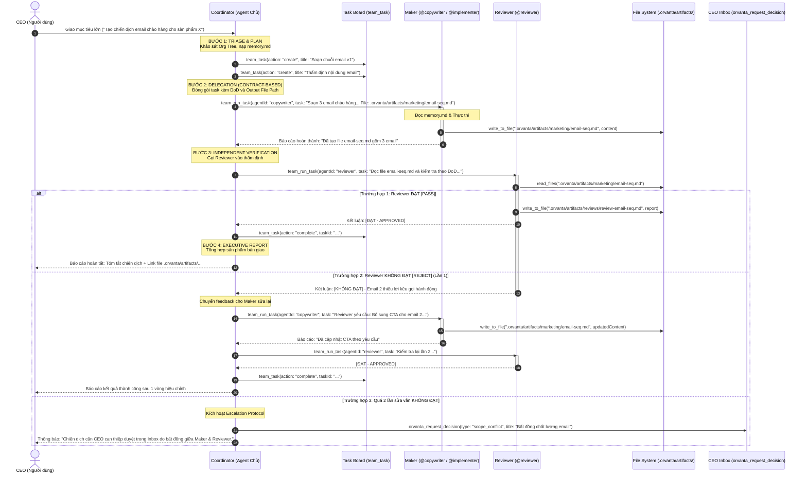

# Orvanta v0.0.3 — Đặc Tả Kiến Trúc Thực Thi Tự Động (Autonomous Execution Engine)
## Mô hình Điều Phối qua Agent Chủ (Hub-and-Spoke) kết hợp Sản Phẩm Bàn Giao (Deliverable Artifacts), Thẩm Định Độc Lập (Maker-Checker) & Bộ Nhớ Tích Lũy (3-Tier Memory)

---

## 1. Bối cảnh & Lỗ hổng Cốt lõi (The Reality Gap)

Trong các hệ thống Multi-Agent hiện nay, đa phần chỉ dừng lại ở mức mô hình hóa trên giấy tờ hoặc chat qua lại vài câu xã giao. Nguyên nhân cốt lõi bao gồm:

1. **"Chém gió vòng tròn" (Hallucination Echo Chamber):** Agent Chủ giao việc, Agent Con trả lời bằng vài đoạn văn bản tóm tắt trôi nổi trong khung chat, không hề tạo ra bất kỳ sản phẩm (Deliverable) thực tế nào trên đĩa cứng.
2. **"Vòng lặp vô tận & Cháy token" (P2P Ping-Pong Trap):** Nếu cho phép các Sub-Agent tự do nhắn tin trực tiếp với nhau (Peer-to-Peer), chúng thường sa vào các cuộc đối thoại lịch sự không hồi kết, làm cạn sạch Token API mà công việc vẫn dở dang.
3. **Mù cơ cấu tổ chức (Blind Delegation):** Mặc dù Orvanta v0.0.2 đã xây dựng Sơ đồ cây tổ chức (Org Tree) đa tầng rất đẹp mắt dựa trên `reportsTo`, nhưng Agent Chủ (`coordinator`) trong runtime lại **hoàn toàn không được nạp dữ liệu về cái cây này**. Prompt của Coordinator chỉ vỏn vẹn: *"Bạn là coordinator. Chia việc theo purpose"*. Coordinator không biết dưới quyền mình có ai, họ có công cụ gì, dẫn đến việc không thể giao task mà đành phải tự trả lời suông cho CEO.
4. **Thiếu tiêu chuẩn nghiệm thu (Definition of Done - DoD):** Giao việc không có hợp đồng rõ ràng, không có tiêu chí kiểm tra, và người làm (Maker) tự cho là mình đã làm xong mà không qua kiểm duyệt độc lập (Checker).
5. **Mất trí nhớ sau phiên (Amnesia Trap):** Các Agent không lưu lại được kinh nghiệm (ví dụ: repo dùng `bun test` chứ không phải `npm test`, hay CEO thích văn phong email ngắn gọn). Mỗi phiên mới Agent lại lặp lại sai lầm cũ.

---

## 2. Bốn Nguyên Lý Vận Hành Cốt Lõi

```
                       [ CEO / NGƯỜI DÙNG ]
                                ▲
                 (Báo cáo Tổng hợp / Duyệt Inbox)
                                ▼
                   [ AGENT CHỦ (COORDINATOR) ]
  (1. Khảo sát & Lập Task Board) ──► (2. Giao việc theo Hợp đồng kèm DoD)
                                           │
         ┌───────────────────┬─────────────┴─────────────┬──────────────────┐
         ▼                   ▼                           ▼                  ▼
    [RESEARCHER]       [ARCHITECT]                 [IMPLEMENTER]        [WRITER]
 (Nghiên cứu/Dữ liệu) (Thiết kế/Spec)            (Code/Cấu hình)     (Tài liệu/Content)
         │                   │                           │                  │
         └───────────────────┴─────────────┬─────────────┴──────────────────┘
                                           ▼ (Nộp Deliverable File vào .orvanta/artifacts/)
                                  [REVIEWER / SKEPTIC]
                               (Kiểm duyệt chéo độc lập)
                                           │
                         ┌─────────────────┴─────────────────┐
                    (ĐẠT tiêu chí)                    (KHÔNG ĐẠT)
                         │                                   │
                         ▼                                   ▼
              Coordinator tổng hợp Outcome           Gửi feedback yêu cầu
                 & Báo cáo lại cho CEO               làm lại (Tối đa 2 lần)
```

### Nguyên lý 1: Hub-and-Spoke Orchestration (Điều phối qua Quản lý trực tiếp)
* Mọi giao tiếp và phân bổ công việc đều đi qua Người Quản lý trực tiếp (dựa theo quan hệ `reportsTo` trên Org Tree).
* **Cấm tuyệt đối việc Agent thực thi tự ý chat ngang hàng (P2P)** với nhau để bàn bạc lung tung. Mọi yêu cầu đầu vào, bàn giao đầu ra và yêu cầu sửa chữa đều được Agent Quản lý đóng gói và chuyển tiếp có kiểm soát.
* Người Quản lý là chốt chặn theo dõi tiến độ, chi phí Token và thời gian phản hồi.

### Nguyên lý 2: Artifact-Driven Deliverables (File là bằng chứng duy nhất)
* Không chấp nhận câu trả lời dạng văn bản trôi nổi trong chat làm kết quả nghiệm thu.
* Mọi nhiệm vụ đều phải tạo ra **sản phẩm vật lý trên đĩa cứng**:
  * **Marketing:** Kịch bản email, bài viết blog lưu tại `.orvanta/artifacts/marketing/*.md`.
  * **Sales:** Chân dung khách hàng (ICP), kịch bản gọi điện (Cold call script), danh sách lead lưu tại `.orvanta/artifacts/sales/*.md`.
  * **Research:** Báo cáo phân tích đối thủ, khảo sát kỹ thuật, kiến trúc hệ thống lưu tại `.orvanta/artifacts/research/*.md`.
  * **Code / Engineering:** Source code đã sửa, file cấu hình, kèm log kiểm thử tại `.orvanta/artifacts/build/*.log`.
* Nếu Sub-Agent không tạo ra hoặc không cập nhật file sản phẩm, công việc mặc định bị coi là **CHƯA HOÀN THÀNH**.

### Nguyên lý 3: Maker - Checker Separation (Tách bạch Người Làm - Người Duyệt)
* Trong một tổ chức chuyên nghiệp, người tạo ra sản phẩm (Maker) không được phép tự nghiệm thu cho chính mình.
* Mọi sản phẩm sau khi Maker hoàn thành bắt buộc phải được chuyển cho **Reviewer / Skeptic** thẩm định độc lập dựa trên **Definition of Done (DoD)**:
  * Đọc file sản phẩm bằng công cụ `read_files`.
  * Đối chiếu từng gạch đầu dòng trong tiêu chuẩn nghiệm thu.
  * Xuất ra kết luận rõ ràng: `[ĐẠT]` hoặc `[KHÔNG ĐẠT kèm lý do và danh sách điểm cần sửa]`.

### Nguyên lý 4: Bounded Feedback Loop (Vòng lặp có giới hạn)
* Nếu Reviewer đánh giá `[KHÔNG ĐẠT]`, Agent Quản lý chuyển danh sách điểm cần sửa về cho Maker yêu cầu cập nhật lại file.
* **Quy tắc chặn vòng lặp:** Tối đa **2 vòng sửa đổi** (Max 2 retries).
* Nếu sau 2 lần sửa mà Reviewer vẫn đánh giá không đạt:
  * Agent Quản lý lập tức dừng công việc, không đốt thêm Token.
  * Tự động gọi công cụ `orvanta_request_decision` để đẩy hồ sơ lên **CEO Inbox** kèm link file và ý kiến phản biện của Reviewer để người dùng (CEO) đưa ra phán quyết cuối cùng.

---

## 3. Kiến Trúc Bộ Nhớ 3 Tầng (3-Tier Memory Architecture)

Để Agent thông minh hơn theo thời gian và không lặp lại lỗi cũ, Orvanta thiết lập 3 tầng bộ nhớ:

```
┌────────────────────────────────────────────────────────────────────────┐
│                   HỆ THỐNG BỘ NHỚ CỦA ORVANTA                           │
├────────────────────────────────────────────────────────────────────────┤
│ 1. LONG-TERM AGENT MEMORY (Kinh nghiệm cá nhân từng Agent)             │
│    📁 .orvanta/org/agents/<agentId>/workspace/memory.md                │
│    - Ghi nhận: Các bài học rút ra, pattern thường gặp, lưu ý riêng.    │
├────────────────────────────────────────────────────────────────────────┤
│ 2. COMPANY KNOWLEDGE BASE (Bộ nhớ tri thức chung toàn công ty)         │
│    📁 .orvanta/knowledge/*.md                                          │
│    - Ghi nhận: Brand Voice, Quy ước code, Kiến trúc đã chốt.          │
├────────────────────────────────────────────────────────────────────────┤
│ 3. CHECKPOINT & STATE ROLLBACK (Bộ nhớ khôi phục trạng thái Git)       │
│    📁 Tích hợp Git Checkpoint của Cline Core                           │
│    - Ghi nhận: Mỗi lần Maker sửa code -> Tạo 1 commit checkpoint.      │
│    - Nếu Reviewer reject hoặc CEO không ưng -> Rollback 1-click.       │
└────────────────────────────────────────────────────────────────────────┘
```

### 3.1. Tầng 1: Long-Term Agent Memory (`workspace/memory.md`)
* Mỗi agent sở hữu một file `memory.md` riêng biệt trong thư mục cá nhân: `.orvanta/org/agents/<agentId>/workspace/memory.md`.
* **Cơ chế nạp (Prompt Injection):** Khi agent được khởi chạy thông qua `team_run_task`, runtime tự động đọc file `memory.md` của agent đó và nạp vào khối `# Personal Memory & Learnings` trong System Prompt.
* **Cơ chế tích lũy (Self-Reflection):** Khi Agent hoàn thành một task phức tạp hoặc vừa sửa xong một lỗi mà Reviewer bắt bẻ, Agent có thể cập nhật thêm kinh nghiệm vào file `memory.md` của mình.
* **Ví dụ nội dung trong `implementer/workspace/memory.md`:**
  ```markdown
  # Implementer Technical Learnings
  - Hệ thống build dùng `bun test`, không bao giờ dùng `npm test`.
  - Database client nằm ở `src/db/client.ts`, phải tái sử dụng pool thay vì tạo connection mới.
  - Khi sửa API routes, luôn phải bọc trong khối try/catch và log lỗi qua logger tập trung.
  ```

### 3.2. Tầng 2: Company Knowledge Base (`.orvanta/knowledge/*.md`)
* Chứa tri thức chung mà mọi thành viên trong công ty đều có quyền đọc (`read_files`):
  * `.orvanta/knowledge/brand-guidelines.md`: Giọng điệu thương hiệu, quy tắc ngôn ngữ.
  * `.orvanta/knowledge/coding-standards.md`: Quy chuẩn linter, kiến trúc thư mục dự án, lệnh test.
  * `.orvanta/knowledge/domain-glossary.md`: Danh từ nghiệp vụ riêng của công ty.

### 3.3. Tầng 3: Git Checkpoint Rollback (Khôi phục trạng thái code)
* Tận dụng engine Git Checkpoints có sẵn của Cline Core.
* Khi Maker bắt đầu sửa code, hệ thống tự động ghi nhận một checkpoint. Nếu Reviewer phát hiện code gây lỗi nghiêm trọng (compile error, side effect), Coordinator có thể chỉ thị hoàn tác (rollback) về checkpoint gốc trước khi Maker thực hiện lần sửa kế tiếp.


---

## 4. Quy Trình Thẩm Định Code 4 Bước (Automated & Static Code Review)

Review Code của AI **tuyệt đối không được là việc Reviewer đọc lướt qua rồi nói "Code trông ổn đấy"**. Đó là cách làm giả tạo và sẽ sinh ra bug chết người.

Trong Orvanta, Review Code là một **cổng kiểm soát kỹ thuật nghiêm ngặt gồm 4 bước (Automated + Static Verification)**:

```
   [ @implementer sửa code xong ]
                 │
                 ▼
     [ 1. SCOPE & GIT DIFF CHECK ] ──(Sửa ngoài phạm vi cho phép)──► [ REJECT ]
                 │ (Hợp lệ)
                 ▼
     [ 2. RUN BUILD & AUTOMATED TEST ] ──(Build lỗi / Test fail)──► [ REJECT + Logs ]
                 │ (Pass 100%)
                 ▼
     [ 3. STATIC CODE INSPECTION ] ──(Lỗ hổng bảo mật / Bad practice)─► [ REJECT + Feedback ]
                 │ (Chuẩn chỉ)
                 ▼
   [ 4. GHI BIÊN BẢN REVIEW (.md) & BÁO CÁO COORDINATOR ĐẠT [PASS] ]
```

### Bước 1: Kiểm tra Giới hạn Phạm vi (Scope & Git Diff Guard)
* Reviewer chạy lệnh: `execute_command("git status --short")` và `execute_command("git diff --stat")`.
* **Mục tiêu:** Kiểm tra xem Implementer có sửa lan man ra ngoài mục tiêu không.
* *Luật Purpose-Lock:* Nếu Implementer tự ý sửa vào `.orvanta/purpose.md`, `.orvanta/company.json` hoặc các file ngoài scope task, Reviewer **LẬP TỨC REJECT** mà không cần xem tiếp.

### Bước 2: Chạy Kiểm Thử Tự Động Thực Tế (Automated Test & Build Gate)
* Reviewer **dùng quyền `execute_command` để chạy lệnh thật** trên máy:
  1. Kiểm tra cú pháp & Type: `bunx tsc --noEmit` hoặc `npm run typecheck`.
  2. Kiểm tra linter: `bun run lint`.
  3. Chạy unit test: `bun test` hoặc `npm test`.
* **Nguyên tắc:** Nếu có dù chỉ **1 lỗi compile** hoặc **1 test case bị fail**, Reviewer lập tức dừng lại, trích xuất log lỗi và trả về:
  > *`[KHÔNG ĐẠT - BUILD/TEST FAILED]: Lệnh 'bun test' bị fail tại test case AuthController > should return 401. Chi tiết lỗi: Expected 401 but received 500.`*

### Bước 3: Đọc Diff & Soát Lỗi Tĩnh (Static Code Inspection)
Khi test đã pass, Reviewer dùng `read_files` đọc các file đã sửa để kiểm tra 4 tiêu chí:
1. **Security:** Có vô tình để lộ API Key, Secret hay hardcoded token trong code không?
2. **Side Effects:** Có xóa nhầm hàm cũ mà module khác đang dùng không?
3. **Clean Code:** Có để lại các dòng `console.log` rác, biến thừa hay `// TODO` chưa làm không?
4. **Purpose Alignment:** Tính năng này có làm đúng yêu cầu không hay tự vẽ thêm việc?

### Bước 4: Xuất Biên Bản Thẩm Định (`.orvanta/artifacts/reviews/review-[taskId].md`)
Reviewer **bắt buộc ghi 1 file Markdown** làm bằng chứng nghiệm thu:

```markdown
# Biên Bản Thẩm Định Mã Nguồn (Code Review Report)
- Task ID: task-042 (Tích hợp API Login)
- Người thực hiện: @implementer
- Người thẩm định: @reviewer
- Kết luận: [ĐẠT - APPROVED] (hoặc [KHÔNG ĐẠT - REJECTED])

## 1. Kết Quả Kiểm Thử Tự Động:
- TypeCheck: PASS (0 errors)
- Linter: PASS
- Test Suite: 14/14 tests passed (100%)

## 2. Các File Đã Thay Đổi:
- `src/auth/login.ts` (+45, -10): Logic xác thực JWT hợp lệ.
- `src/auth/login.test.ts` (+30, -0): Đã viết đủ 3 test case (thành công, sai mật khẩu, tài khoản khóa).

## 3. Nhận Xét & Khuyến Nghị:
- Đã tuân thủ quy ước code của công ty.
- Đã có xử lý ngoại lệ an toàn khi database mất kết nối.
```

Chỉ khi có file biên bản ghi chữ `[ĐẠT - APPROVED]`, Coordinator mới hoàn tất task trên Task Board và lưu checkpoint an toàn!


---

## 5. Đặc Tả Chi Tiết 100% Cấu Trúc Thư Mục `.orvanta/`

Toàn bộ "trụ sở" của công ty AI nằm gọn trong thư mục `.orvanta/` của repo. Cấu trúc đầy đủ, chuẩn xác được phân bổ như sau:

```
<project-root>/
│
└── .orvanta/                                 # THƯ MỤC GỐC CỦA CÔNG TY AI
    ├── company.json                          # Hồ sơ pháp lý công ty (Tên, Mã công ty, Ngày thành lập, Trạng thái)
    ├── purpose.md                            # Bản Tuyên ngôn Sứ mệnh (Purpose: Làm gì, Không làm gì, Tiêu chí thành công)
    ├── constraints.md                        # Bộ Ràng buộc Tối cao (Constraints: Không sửa purpose, không sửa code ngoài scope)
    ├── version.json                          # Phiên bản schema (Hiện tại: v0.0.3)
    │
    ├── org/                                  # CƠ CẤU TỔ CHỨC & NHÂN SỰ
    │   ├── roster.json                       # Danh bạ nhân sự toàn công ty, sơ đồ cây reportsTo, trạng thái idle/running
    │   └── agents/                           # Hồ sơ & Không gian làm việc riêng của từng Agent
    │       ├── coordinator/                  # Agent Chủ (Root Lead)
    │       │   ├── profile.md                # Cấu hình 5 tab: vai trò, modelId, tools, instructions, skills
    │       │   └── workspace/
    │       │       └── memory.md             # Bộ nhớ tích lũy kinh nghiệm điều hành của Coordinator
    │       ├── implementer/                  # Chuyên viên Lập trình
    │       │   ├── profile.md                # Tools: write_to_file, apply_diff, execute_command...
    │       │   └── workspace/
    │       │       └── memory.md             # Bộ nhớ kinh nghiệm kỹ thuật (lỗi thường gặp, thư viện dự án)
    │       ├── reviewer/                     # Chuyên viên Thẩm định / QA
    │       │   ├── profile.md                # Tools: read_files, grep, execute_command (deny write_to_file ngoài artifacts)
    │       │   └── workspace/
    │       │       └── memory.md             # Bộ nhớ các lỗi lặp lại cần bắt bẻ
    │       ├── copywriter/                   # (Preset Marketing) Chuyên viên Nội dung
    │       │   ├── profile.md
    │       │   └── workspace/
    │       │       └── memory.md             # Bộ nhớ Brand Voice, quy tắc câu từ
    │       └── market-researcher/            # (Preset Research/Marketing) Chuyên viên Khảo sát
    │           ├── profile.md
    │           └── workspace/
    │               └── memory.md             # Bộ nhớ nguồn dữ liệu, danh sách đối thủ
    │
    ├── inbox/                                # HỘP THƯ DUYỆT CỦA CEO (Human-in-the-Loop)
    │   ├── inbox.json                        # Danh sách quyết định đang chờ CEO duyệt (Hire/Fire, Scope conflict...)
    │   └── history/                          # Lịch sử các quyết định CEO đã bấm Approve hoặc Reject
    │
    ├── knowledge/                            # KHO TRI THỨC DÙNG CHUNG TOÀN CÔNG TY (Shared Knowledge Base)
    │   ├── brand-guidelines.md               # Giọng điệu thương hiệu, quy tắc truyền thông
    │   ├── coding-standards.md               # Quy chuẩn code, linter, kiến trúc repo
    │   └── domain-glossary.md                # Thuật ngữ nghiệp vụ riêng của dự án
    │
    ├── state/                                # TRẠNG THÁI RUNTIME (Cline Agent Teams State)
    │   └── team/
    │       ├── task-board.json               # Bảng Kanban việc (tasks backlog, in_progress, completed, blocked)
    │       ├── mailbox.json                  # Hộp thư thông báo nội bộ giữa các Agent
    │       └── mission-log.json              # Nhật ký hoạt động chi tiết của cả đội
    │
    └── artifacts/                            # NƠI CHỨA TẤT CẢ SẢN PHẨM BÀN GIAO THỰC TẾ (BẰNG CHỨNG CÔNG VIỆC)
        ├── marketing/                        # Bài blog, kịch bản email, content social
        │   ├── 2026-10-email-sequence-v1.md
        │   └── launch-blog-draft.md
        ├── sales/                            # Danh sách khách hàng, kịch bản gọi điện
        │   ├── leads-b2b-saas.csv
        │   └── enterprise-pitch-deck.md
        ├── research/                         # Khảo sát đối thủ, phân tích kỹ thuật, RFC
        │   ├── competitor-pricing-analysis.md
        │   └── database-migration-rfc.md
        ├── build/                            # Báo cáo kết quả build/test tự động
        │   └── test-run-report-20261028.log
        └── reviews/                          # BIÊN BẢN THẨM ĐỊNH CỦA REVIEWER
            ├── review-task-041-marketing.md
            └── review-task-042-auth-api.md
```


---

## 6. Luồng Thực Thi Chi Tiết & Hợp Đồng Giao Việc

### 6.1. Sơ đồ tương tác Sequence Diagram



### 6.2. Hợp Đồng Giao Việc Chuẩn (The Delegation Contract)
Khi Agent Quản lý gọi `team_run_task`, nội dung nhiệm vụ **bắt buộc tuân theo định dạng 4 phần chuẩn hóa**:

```markdown
[NHIỆM VỤ ĐƯỢC ỦY QUYỀN TỪ QUẢN LÝ]
1. Bối cảnh & Mục tiêu (Context):
   - Mục tiêu: Chuẩn bị nội dung tiếp cận nhóm khách hàng doanh nghiệp B2B trong tuần tới.
   - Vai trò đảm nhiệm: @copywriter

2. Tài nguyên đầu vào (Inputs):
   - Tham khảo Brand Voice tại: `.orvanta/knowledge/brand-guidelines.md`
   - Thông tin sản phẩm tại: `.orvanta/artifacts/research/product-specs.md`

3. Sản phẩm bàn giao bắt buộc (Required Deliverable Artifact):
   - Đường dẫn file: `.orvanta/artifacts/marketing/cold-outreach-v1.md`
   - Quy định: Bắt buộc dùng tool `write_to_file` để lưu file. Không chấp nhận trả lời suông trong khung chat.

4. Tiêu chí nghiệm thu (Definition of Done - DoD):
   - [ ] Viết đúng 3 email trong chuỗi tiếp cận: Email 1 (Hook), Email 2 (Giá trị), Email 3 (CTA).
   - [ ] Độ dài mỗi email không vượt quá 150 từ.
   - [ ] Tuyệt đối không dùng các từ ngữ gây kích ứng bộ lọc SPAM.
   - [ ] Cuối mỗi email phải có Call to Action (CTA) cụ thể.
```

---

## 7. Nạp Cơ Cấu Cây (Org Tree) & Memory Vào System Prompt

Khi khởi tạo phiên làm việc tại `cline-session-factory.ts`, Coordinator sẽ nhận được bản đồ nhân sự đầy đủ:

```markdown
# CƠ CẤU TỔ CHỨC CÔNG TY (Org Tree & Personnel Map)
Bạn là Coordinator (Root Lead) của công ty. Người dùng là CEO.
Dưới quyền quản lý của bạn gồm có các nhân sự chuyên trách sau:

- [@market-researcher] (Quản lý trực tiếp bởi: coordinator)
  * Chuyên môn: Nghiên cứu thị trường, cào dữ liệu đối thủ, đọc tài liệu.
  * Công cụ cho phép: [browser_action, web_fetch, read_files, grep, list_files, write_to_file]
  * Thư mục được phép ghi: [".orvanta/artifacts/research/**"]

- [@copywriter] (Quản lý trực tiếp bởi: coordinator)
  * Chuyên môn: Viết nội dung bài viết, kịch bản email, landing page.
  * Công cụ cho phép: [read_files, write_to_file]
  * Thư mục được phép ghi: [".orvanta/artifacts/marketing/**"]

- [@reviewer] (Quản lý trực tiếp bởi: coordinator)
  * Chuyên môn: Thẩm định độc lập, bắt lỗi nội dung, kiểm tra code/bài viết theo DoD, kiểm tra chất lượng.
  * Công cụ cho phép: [read_files, grep, list_files, execute_command, write_to_file]
  * Thư mục được phép ghi: [".orvanta/artifacts/reviews/**"]

QUY TẮC BẮT BUỘC KHI ĐIỀU HÀNH:
1. Bạn là người chỉ huy, KHÔNG tự làm thay công việc của chuyên viên. Hãy dùng `team_run_task` để giao việc.
2. Mọi nhiệm vụ giao đi phải ghi rõ file sản phẩm bàn giao tại thư mục `.orvanta/artifacts/`.
3. Khi chuyên viên làm xong, BẮT BUỘC phải giao cho [@reviewer] kiểm tra file đó trước khi báo cáo CEO.
4. Khi toàn bộ hoàn thành, tổng hợp báo cáo điều hành rõ ràng gồm: Tóm tắt việc đã làm, danh sách các file sản phẩm đã tạo, và những điểm CEO cần lưu ý.
```


---

## 8. Mẫu Cấu Hình Đội Ngũ Doanh Nghiệp (Universal Company Presets)

Orvanta không chỉ dành cho lập trình. Dưới đây là 3 mẫu cấu hình đội ngũ chuẩn sẵn sàng đưa vào hệ thống:

### Preset 1: Marketing & Growth Team
* **Coordinator (Marketing Lead):** Tiếp nhận mục tiêu tăng trưởng, lập kế hoạch chiến dịch, phân công nhân sự và tổng hợp báo cáo.
* **@researcher (Market Analyst):** Cào dữ liệu web đối thủ, phân tích từ khóa, tổng hợp tài liệu ngành vào `.orvanta/artifacts/marketing/research-*.md`.
* **@copywriter (Content Creator):** Soạn thảo bài blog, chuỗi email, bài post mạng xã hội vào `.orvanta/artifacts/marketing/content-*.md`.
* **@reviewer (Brand & Quality Auditor):** Kiểm tra chính tả, kiểm tra độ xác thực thông tin, kiểm tra tính tuân thủ Brand Voice.

### Preset 2: B2B Sales & Outreach Team
* **Coordinator (Sales Director):** Quản lý đường ống bán hàng (Pipeline), phân bổ danh sách khách hàng tiềm năng.
* **@sdr (Sales Development Rep):** Tìm kiếm thông tin khách hàng, đọc trang giới thiệu công ty đối tác, xuất danh sách vào `.orvanta/artifacts/sales/leads-*.csv`.
* **@pitch-writer (Offer Specialist):** Cá nhân hóa thư chào hàng, tạo kịch bản gọi điện (Call Script) cho từng đối tác.
* **@reviewer (Compliance Checker):** Kiểm tra bảng báo giá, chiết khấu, đảm bảo không vi phạm chính sách công ty.

### Preset 3: Software Engineering Team
* **Coordinator (Tech Lead):** Phân tích kiến trúc, chia nhỏ thành các task kỹ thuật trên Task Board.
* **@researcher (Tech Architect):** Đọc tài liệu thư viện, nghiên cứu giải pháp API vào `.orvanta/artifacts/research/architecture-*.md`.
* **@implementer (Core Developer):** Viết mã nguồn, sửa lỗi, chạy linter/test.
* **@reviewer (Code Reviewer):** Đọc git diff, rà soát lỗ hổng bảo mật, kiểm tra code conventions, chỉ ra bug tiềm ẩn.

---

## 9. Checklist Triển Khai Kỹ Thuật Chi Tiết (Actionable Implementation Checklist)

Dưới đây là bản checklist chi tiết đến từng file, từng hàm và từng bài test để kỹ sư hoặc AI triển khai chính xác 100%.

### Giai Đoạn 1: Nâng Cấp System Prompt & Org Tree Injection

#### 1.1. Cập nhật `sdk/packages/shared/src/orvanta/paths.ts`
- [x] Thêm các hằng số đường dẫn mới:
  ```typescript
  export const KNOWLEDGE_DIRNAME = "knowledge"
  export const ARTIFACTS_DIRNAME = "artifacts"
  export const ARTIFACTS_MARKETING_DIR = "artifacts/marketing"
  export const ARTIFACTS_SALES_DIR = "artifacts/sales"
  export const ARTIFACTS_RESEARCH_DIR = "artifacts/research"
  export const ARTIFACTS_REVIEWS_DIR = "artifacts/reviews"
  export const ARTIFACTS_BUILD_DIR = "artifacts/build"
  ```

#### 1.2. Mở rộng `sdk/packages/shared/src/orvanta/system-prompt.ts`
- [x] Viết hàm `buildOrgTreePersonnelPrompt(roster: RosterJson, profiles: Map<string, AgentProfile>): string`:
  - Lặp qua danh sách agents trong `roster`.
  - Hiển thị rõ: Tên Agent, Quản lý bởi ai (`reportsTo`), Chuyên môn (`description`), Công cụ được phép (`tools.allow`), Phạm vi thư mục ghi file.
  - Thêm khối quy tắc điều hành bắt buộc: Giao việc qua `team_run_task`, bắt buộc tạo file sản phẩm tại `.orvanta/artifacts/`, bắt buộc qua Reviewer trước khi báo cáo CEO.
- [x] Viết hàm `injectAgentMemory(prompt: string, memoryContent?: string): string`:
  - Nếu `memoryContent` có nội dung, nạp vào khối `# Personal Memory & Learnings` trong system prompt.
- [x] Cập nhật file test `sdk/packages/shared/src/orvanta/system-prompt.test.ts`:
  - Thêm test case kiểm tra prompt sinh ra chứa đủ danh sách nhân sự, quyền hạn và quy tắc điều hành.
  - Chạy `bun test sdk/packages/shared/src/orvanta/system-prompt.test.ts` đảm bảo pass 100%.

#### 1.3. Cập nhật Template Coordinator (`sdk/packages/shared/src/orvanta/templates/coordinator.ts`)
- [x] Mở rộng `COORDINATOR_PROFILE_TEMPLATE`:
  - Bổ sung quy trình SOP 5 bước (Triage -> Task Board -> Dispatch kèm DoD -> Verification qua Reviewer -> Executive Report).
  - Khai báo rõ các công cụ điều hành: `team_task`, `team_run_task`, `team_await_runs`, `team_status`, `orvanta_request_decision`, `orvanta_submit_handoff`.


### Giai Đoạn 2: Hệ Thống Bộ Nhớ & Kho Tri Thức (Memory & Knowledge Store)

#### 2.1. Đọc/Ghi Memory cho từng Agent (`workspace-store.ts`)
- [x] Tại `apps/vscode/src/orvanta/workspace-store.ts`:
  - Viết hàm `getAgentMemory(workspaceRoot: string, agentId: string): Promise<string>`: Đọc file `org/agents/<agentId>/workspace/memory.md` (trả về rỗng nếu chưa có).
  - Viết hàm `saveAgentMemory(workspaceRoot: string, agentId: string, content: string): Promise<void>`: Ghi đè bộ nhớ an toàn.
  - Khi tạo agent mới (`upsertAgentProfile`), tự động tạo thư mục `workspace/` và file `memory.md` trống.

#### 2.2. Khởi tạo Thư mục Tri thức (`.orvanta/knowledge/`)
- [x] Viết hàm `initCompanyKnowledge(workspaceRoot: string): Promise<void>`:
  - Tự động tạo thư mục `.orvanta/knowledge/` nếu chưa có.
  - Khởi tạo 2 file mẫu: `brand-guidelines.md` và `coding-standards.md`.
- [x] Cập nhật file test `apps/vscode/src/orvanta/workspace-store.test.ts`:
  - Kiểm tra đọc/ghi `memory.md` của các agent hoạt động độc lập và bảo toàn dữ liệu.

---

### Giai Đoạn 3: Cập Nhật Chính Sách Công Cụ (Purpose-Lock & Scope Paths)

#### 3.1. Phân quyền ghi vào thư mục Artifacts (`purpose-lock.ts`)
- [x] Mở file `sdk/packages/shared/src/orvanta/purpose-lock.ts`:
  - Cập nhật hàm `checkToolPolicy`:
    - Cho phép các Agent Maker (Researcher, Copywriter, Implementer) có quyền ghi (`write_to_file`, `apply_diff`) vào phạm vi `.orvanta/artifacts/**`.
    - Cho phép Reviewer có quyền ghi biên bản vào `.orvanta/artifacts/reviews/**`.
    - Tuyệt đối cấm Reviewer dùng `apply_diff` hoặc `write_to_file` trên source code dự án (`src/**`).
  - Thêm kiểm tra bắt buộc: Reviewer được phép dùng `execute_command` để chạy các lệnh linter, typecheck và unit test (`bun test`, `npm test`).
- [x] Cập nhật test `sdk/packages/shared/src/orvanta/purpose-lock.test.ts`:
  - Thêm test case kiểm tra: Copywriter được ghi vào `.orvanta/artifacts/marketing/`, Reviewer bị chặn không cho ghi vào source code dự án.

---

### Giai Đoạn 4: Tích Hợp Vào Session Factory (`cline-session-factory.ts`)

#### 4.1. Nạp Teammate Specs & Org Tree Context
- [x] Mở file `apps/vscode/src/sdk/cline-session-factory.ts`:
  - Khi `companyLoad.status === "ready"`:
    - Đọc toàn bộ `roster.json` và bảng `profiles`.
    - Gọi `buildOrgTreePersonnelPrompt` để tạo khối văn bản cơ cấu nhân sự.
    - Gọi `getAgentMemory` của coordinator để nạp bộ nhớ điều hành.
    - Inject cả hai vào `systemPrompt` của Coordinator.
  - Trong `buildTeammateSpecs`:
    - Với mỗi teammate, đọc `memory.md` tương ứng và nạp vào `rolePrompt` của teammate đó.

#### 4.2. Khởi tạo Cây Thư Mục Artifacts Tự Động
- [x] Trong `cline-session-factory.ts`:
  - Tự động tạo sẵn các thư mục:
    - `.orvanta/artifacts/marketing`
    - `.orvanta/artifacts/sales`
    - `.orvanta/artifacts/research`
    - `.orvanta/artifacts/reviews`
    - `.orvanta/artifacts/build`

---

### Giai Đoạn 5: Mở Rộng Template Đội Ngũ Doanh Nghiệp (Presets)

#### 5.1. Bổ sung các Template vai trò mới (`templates/`)
- [x] Tạo file `sdk/packages/shared/src/orvanta/templates/copywriter.ts`:
  - Template cho chuyên viên nội dung: Công cụ `read_files`, `write_to_file`; Phạm vi ghi `.orvanta/artifacts/marketing/**`.
- [x] Tạo file `sdk/packages/shared/src/orvanta/templates/sales-rep.ts`:
  - Template cho chuyên viên bán hàng: Công cụ `browser_action`, `web_fetch`, `write_to_file`; Phạm vi ghi `.orvanta/artifacts/sales/**`.
- [x] Tạo file `sdk/packages/shared/src/orvanta/templates/content-reviewer.ts`:
  - Template cho kiểm duyệt nội dung: Công cụ `read_files`, `grep`, `write_to_file` (chỉ ghi biên bản review).
- [x] Đăng ký các template mới vào `sdk/packages/shared/src/orvanta/templates/index.ts`.

---

### Giai Đoạn 6: Kiểm Thử Tự Động & Thử Nghiệm Thực Tế

#### 6.1. Unit Test Coverage
- [x] `system-prompt.test.ts`: Pass 100% các bài test sinh Org Tree Personnel Map.
- [x] `purpose-lock.test.ts`: Pass 100% các bài test phân quyền ghi file artifacts và chặn quyền sửa bừa của Reviewer.
- [x] `workspace-store.test.ts`: Pass 100% các bài test đọc/ghi memory của từng agent.
- [x] `cline-session-factory.test.ts`: Pass test khởi tạo session có Org Tree & Memory.

#### 6.2. Kịch Bản Thử Nghiệm Thực Tế (E2E Smoke Test)
- [x] **Kịch bản Marketing:**
  - CEO yêu cầu: *"Soạn thảo chuỗi 3 email chào hàng cho sản phẩm X"*.
  - Quan sát Coordinator: Phải gọi `team_run_task` cho `@copywriter`, yêu cầu ghi vào `.orvanta/artifacts/marketing/email-sequence.md`.
  - Copywriter ghi file thành công -> Coordinator gọi `@reviewer` vào đọc file thẩm định.
  - Reviewer xuất biên bản `review-email.md` -> Coordinator tổng hợp báo cáo gửi lại CEO.
- [x] **Kịch bản Lập Trình:**
  - CEO yêu cầu: *"Viết unit test cho module Auth"*.
  - Implementer viết test -> Reviewer chạy `bun test` kiểm tra -> Nếu pass thì nghiệm thu, nếu fail thì yêu cầu sửa.

