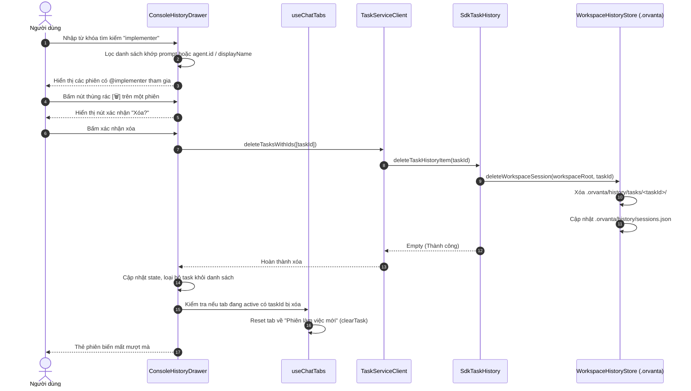

# Orvanta v0.1.0 — Đặc Tả Bổ Sung: Quản Lý Lịch Sử, Lưu Trữ Đầy Đủ Agent & Tối Giản Giao Diện

> **Tài liệu bổ sung cho phiên bản v0.1.0**  
> **Kế thừa từ:** [`01-CHROME-TABS-AND-HISTORY-SPEC.md`](./01-CHROME-TABS-AND-HISTORY-SPEC.md)  
> **Trạng thái:** Dự thảo chi tiết & Checklist triển khai  
> **Mục tiêu:** Cung cấp chức năng xóa cuộc trò chuyện, lưu trữ trọn vẹn thông tin các Agent tham gia vào lịch sử dự án (`.orvanta/history/`), đồng thời tinh giản khay Lịch sử bằng cách loại bỏ các nút lọc dư thừa và tập trung vào trải nghiệm tìm kiếm toàn văn thông minh.

---

## 1. Bối Cảnh & Động Lực Thay Đổi (Context & Motivation)

Sau khi hoàn thiện kiến trúc cơ bản cho hệ thống Chrome-like Tabs và lưu trữ lịch sử tại thư mục dự án `.orvanta/history/`, quá trình đánh giá thực tế cho thấy 3 điểm cần nâng cấp thiết yếu:

1. **Nhu cầu xóa cuộc trò chuyện cũ (Session Cleanup):**
   - Người dùng thường xuyên thực hiện các tác vụ thử nghiệm hoặc các câu lệnh ngắn. Khi các phiên này tích tụ, danh sách lịch sử trở nên lộn xộn.
   - Hiện tại, người dùng chưa thể xóa trực tiếp một phiên làm việc khỏi khay Lịch sử (`ConsoleHistoryDrawer`) trên giao diện Console. Cần có nút xóa kèm cơ chế xác nhận an toàn, đồng thời xóa triệt để cả trong hệ thống và thư mục dự án `.orvanta/history/tasks/<taskId>`.

2. **Thiếu thông tin chi tiết về các Agent tham gia (Full Agent Metadata Persistence):**
   - Trước đây, lịch sử phiên chỉ lưu trữ mảng chuỗi đơn giản `agentIds: string[]` hoặc thiếu dữ liệu hồ sơ Agent.
   - Khi xem lại lịch sử, người dùng không thể biết rõ phiên đó gồm những Agent nào, vai trò của từng Agent ra sao (`lead` hay `teammate`), tên hiển thị đầy đủ là gì (`Coordinator (Lead)`, `Code Implementer`...).
   - Yêu cầu đặt ra: Lịch sử phải lưu trữ **đầy đủ thông tin của tất cả các Agent** cấu hình trong phiên vào `sessions.json` và file `metadata.json` của từng task, đồng thời hiển thị huy hiệu (badges) trực quan của từng Agent trên mỗi thẻ lịch sử.

3. **Giao diện khay Lịch sử bị rối mắt bởi các nút lọc (Streamlined Search-Only Drawer):**
   - Khay Lịch sử hiện có các chip lọc nút bấm: *"Hôm nay"*, *"Tất cả"*, *"@coordinator"*, *"@implementer"*, *"@reviewer"*.
   - Trong thực tế, các nút lọc này chiếm dụng không gian dọc quý giá, làm rối mắt và không linh hoạt khi công ty có nhiều Agent tùy biến khác nhau.
   - **Giải pháp:** Bỏ hoàn toàn các nút/chip lọc này. Thay vào đó, tập trung tối ưu **thanh tìm kiếm toàn văn duy nhất (Universal Search Bar)**: Cho phép người dùng gõ tìm kiếm theo tiêu đề, prompt, task ID, hoặc gõ tên bất kỳ Agent nào để tìm nhanh chóng.

---

## 2. Kiến Trúc & Giải Pháp Kỹ Thuật (Architecture & Solutions)

### 2.1. Cấu Trúc Dữ Liệu Lưu Trữ Đầy Đủ Thông Tin Agent

#### A. Định nghĩa kiểu dữ liệu `OrvantaSessionAgentInfo`
Trong thư viện dùng chung `sdk/packages/shared/src/orvanta/workspace-history-store.ts`, mở rộng kiểu dữ liệu đại diện cho Agent trong phiên:

```typescript
/**
 * Thông tin chi tiết của một Agent tham gia vào phiên làm việc
 */
export interface OrvantaSessionAgentInfo {
  /** Mã định danh duy nhất của Agent (vd: "coordinator", "implementer") */
  id: string
  /** Tên hiển thị đầy đủ (vd: "Coordinator (Lead)", "Frontend Developer") */
  displayName: string
  /** Vai trò phân cấp trong tổ chức */
  role: "lead" | "teammate"
  /** Đường dẫn hoặc tên icon/avatar đại diện (nếu có) */
  avatarUrl?: string
  /** Model LLM mà Agent sử dụng trong phiên (nếu có) */
  model?: string
}

/**
 * Bản ghi phiên làm việc trong .orvanta/history/sessions.json
 */
export interface OrvantaSessionRecord {
  id: string
  title: string
  createdAt: number
  updatedAt: number
  tokensIn?: number
  tokensOut?: number
  totalCost?: number
  status?: "running" | "completed" | "interrupted" | "error"
  isFavorited?: boolean
  
  /** Mảng ID các Agent (giữ lại tương thích ngược) */
  agentIds?: string[]
  /** THÔNG TIN ĐẦY ĐỦ CỦA TẤT CẢ CÁC AGENT THAM GIA PHIÊN */
  agents: OrvantaSessionAgentInfo[]
  /** Agent đang được chọn hoặc tương tác gần nhất */
  activeAgentId?: string
}
```

#### B. Cấu trúc lưu trữ thư mục `.orvanta/history/`
```
<Thư mục dự án>/
└── .orvanta/
    └── history/
        ├── sessions.json           # Danh mục chứa đầy đủ metadata & mảng `agents`
        └── tasks/
            └── <taskId>/
                ├── ui_messages.json # Toàn bộ transcript trao đổi
                └── metadata.json   # Chi tiết cấu hình snapshot của các Agent tại thời điểm chạy
```


---

### 2.2. Cơ Chế Xóa Lịch Sử Cuộc Trò Chuyện (Session Deletion)

#### A. Luồng tương tác người dùng (UI/UX)
1. Trong `ConsoleHistoryDrawer`, trên mỗi thẻ phiên (`TaskCard`):
   - Bên cạnh nút mở cuộc trò chuyện (`IconExternalLink`), bổ sung nút xóa hình thùng rác (`<IconTrash size={13} />`).
   - Nút xóa mặc định ẩn hoặc mờ nhẹ, hiển thị rõ khi hover vào card phiên.
2. **Cơ chế xác nhận an toàn (Inline Confirmation):**
   - Khi bấm vào icon thùng rác lần đầu:
     - Nút chuyển sang trạng thái cảnh báo màu đỏ với nhãn *"Xóa?"* hoặc icon xác nhận `<IconCheck size={13} className="text-red-400" />`.
     - Kèm nút hủy hoặc tự động hoàn nguyên sau 4 giây nếu không bấm tiếp.
   - Bấm xác nhận xóa: Kích hoạt gọi API xóa.

```
┌─────────────────────────────────────────────────────────────┐
│ Khắc phục lỗi render Virtual DOM                            │
│ 🤖 @coordinator (Lead)   🤖 @implementer                    │
│ 🕒 10 phút trước  •  1,420 tokens  •  $0.012                │
│                                           [ Mở ] [ 🗑️ Xóa ] │
└─────────────────────────────────────────────────────────────┘
                                                ▲
                                                │ (Bấm icon thùng rác)
┌─────────────────────────────────────────────────────────────┐
│ Bạn có chắc muốn xóa cuộc trò chuyện này?                   │
│                                    [ Hủy ] [ Xác nhận xóa ] │
└─────────────────────────────────────────────────────────────┘
```

#### B. Luồng xử lý backend & đồng bộ dữ liệu
1. **Frontend gRPC Call:**
   ```typescript
   await TaskServiceClient.deleteTasksWithIds(
     StringArrayRequest.create({ value: [taskId] })
   )
   ```
2. **Backend Processing (`SdkTaskHistory` & `WorkspaceHistoryStore`):**
   - Xóa task khỏi cache bộ nhớ của `SdkTaskHistory`.
   - Gọi `deleteWorkspaceSession(workspaceRoot, taskId)`:
     - Xóa thư mục `.orvanta/history/tasks/<taskId>/` (bao gồm `ui_messages.json` và `metadata.json`).
     - Đọc file `.orvanta/history/sessions.json`, lọc bỏ session có `id === taskId`, và ghi đè lại file.
   - Nếu `taskId` đang là task hiện tại của Controller (`controller.task?.taskId === taskId`), tự động giải phóng phiên bằng `clearTask()`.
3. **Phản hồi giao diện Webview:**
   - Xóa ngay lập tức item khỏi danh sách hiển thị trong Drawer (`filteredTasks`).
   - Nếu có Tab trên `ChromeTabBar` đang gắn với `taskId` vừa bị xóa:
     - Tự động gỡ bỏ `taskId` khỏi tab (`tab.taskId = undefined`) và đổi tiêu đề tab về *"Phiên làm việc mới"*, đưa khung chat về trạng thái sạch sẽ.

---

### 2.3. Tối Giản Giao Diện Khay Lịch Sử: Bỏ Lọc, Tối Ưu Tìm Kiếm

#### A. Loại bỏ thành phần lọc (Filter Removal)
- **Gỡ bỏ:**
  - Nút bấm *"Hôm nay"* (`filterTodayOnly`).
  - Hàng nút bấm lọc theo Agent (`selectedAgent`): *"Tất cả"*, *"@coordinator"*, *"@implementer"*, *"@reviewer"*.
  - Các biến state và logic điều kiện lọc tương ứng trong `useMemo`.
- **Lợi ích:**
  - Tiết kiệm 45px không gian hiển thị trên đầu ngăn kéo.
  - Loại bỏ hoàn toàn sự phụ thuộc cứng vào danh sách tên agent cố định.
  - Giao diện thanh thoát, trực quan và hiện đại hơn.

#### B. Nâng cấp thanh tìm kiếm toàn năng (Universal Smart Search)
- Thanh tìm kiếm duy nhất (`<IconSearch />`) ở đỉnh Drawer đóng vai trò là công cụ tìm kiếm và lọc duy nhất:
- Logic khớp dữ liệu (`Smart Matching`):
  1. Khớp theo nội dung prompt / tiêu đề phiên (`task.title` hoặc `task.prompt`).
  2. Khớp theo mã định danh `taskId`.
  3. Khớp theo **ID của Agent** tham gia phiên (vd: người dùng gõ `"implementer"`, `"coordinator"`).
  4. Khớp theo **Tên hiển thị của Agent** (vd: gõ `"lead"`, `"reviewer"`, `"tester"`).
- Khi người dùng muốn xem các phiên có sự tham gia của một Agent nào đó, họ chỉ việc gõ tên hoặc vai trò của Agent đó vào ô tìm kiếm.

#### C. Hiển thị huy hiệu Agent trực quan trên thẻ phiên
- Trên mỗi thẻ phiên trong danh sách, hiển thị một hàng các badge nhỏ đại diện cho tất cả Agent tham gia:
  ```tsx
  <div className="flex items-center gap-1 flex-wrap mt-1">
    {task.agents?.map(agent => (
      <span 
        key={agent.id} 
        className="inline-flex items-center gap-1 px-1.5 py-0.5 rounded text-[10px] bg-[var(--vscode-badge-background)] text-[var(--vscode-badge-foreground)]"
        title={`${agent.displayName} (${agent.role})`}>
        <IconRobot size={10} />
        <span>@{agent.id}</span>
      </span>
    ))}
  </div>
  ```


---

## 3. Sơ Đồ Trình Tự Thực Thi (Sequence Diagram)



---

## 4. Checklist Triển Khai Chi Tiết (Actionable Checklist)

### 📋 Phase 1: Mở Rộng Schema & Lưu Trữ Đầy Đủ Metadata Agent
- [x] **1.1.** Cập nhật `sdk/packages/shared/src/orvanta/workspace-history-store.ts`:
  - Khai báo interface `OrvantaSessionAgentInfo` (`id`, `displayName`, `role`, `avatarUrl`, `model`).
  - Cập nhật interface `OrvantaSessionRecord` có trường `agents: OrvantaSessionAgentInfo[]`.
  - Hỗ trợ lưu trữ file `metadata.json` chứa snapshot toàn bộ Agent trong thư mục `tasks/<taskId>/metadata.json`.
- [x] **1.2.** Cập nhật `apps/vscode/src/sdk/sdk-task-history.ts`:
  - Trong phương thức `updateTaskHistoryItem`: Trích xuất danh sách tất cả các Agent từ `company.roster` hoặc cấu hình hiện tại để lưu đầy đủ thông tin vào `saveWorkspaceSession`.
- [x] **1.3.** Cập nhật unit test `sdk/packages/shared/src/orvanta/workspace-history-store.test.ts`:
  - Viết kiểm thử lưu và đọc phiên có đầy đủ mảng `agents`.
  - Chạy `bun run build:sdk` để cập nhật gói thư viện.

### 📋 Phase 2: Triển Khai & Kiểm Thử Chức Năng Xóa Lịch Sử Tại Backend
- [x] **2.1.** Tối ưu hàm `deleteWorkspaceSession` trong `workspace-history-store.ts`:
  - Đảm bảo xóa sạch cả thư mục `tasks/<taskId>/` và cập nhật loại bỏ khỏi `sessions.json`.
- [x] **2.2.** Tích hợp xóa an toàn trong `apps/vscode/src/sdk/sdk-task-history.ts`:
  - Khi nhận `deleteTaskHistoryItem(sessionId)`: Tự động lấy thư mục workspace và gọi `deleteWorkspaceSession` cho cả phiên SDK lẫn legacy task.
- [x] **2.3.** Viết unit test backend cho trường hợp xóa phiên làm việc và xác minh file trên đĩa bị xóa.

### 📋 Phase 3: Tối Giản Giao Diện Khay Lịch Sử (`ConsoleHistoryDrawer.tsx`)
- [x] **3.1. Loại bỏ các nút lọc:**
  - Xóa state `filterTodayOnly` và `selectedAgent`.
  - Xóa toàn bộ khối render các chip button *"Hôm nay"*, *"Tất cả"*, *"@coordinator"*, *"@implementer"*, *"@reviewer"*.
- [x] **3.2. Nâng cấp thanh tìm kiếm toàn năng:**
  - Cập nhật hàm lọc tìm kiếm: Khớp `query` với tiêu đề, `task.id`, `agent.id`, `agent.displayName`, `agent.role`.
  - Hiển thị số lượng kết quả tìm thấy ngay góc thanh search hoặc cạnh tiêu đề.
- [x] **3.3. Hiển thị danh sách Agent Badges trên từng thẻ phiên:**
  - Hiển thị các pill badge thu nhỏ của các Agent tham gia phiên (`@coordinator`, `@implementer`...).
- [x] **3.4. Bổ sung nút Xóa cuộc trò chuyện:**
  - Thêm nút `<IconTrash size={13} />` trên từng thẻ phiên.
  - Xây dựng cơ chế xác nhận inline an toàn (bấm lần 1 hỏi xác nhận, bấm lần 2 gọi xóa).
  - Tích hợp gọi `TaskServiceClient.deleteTasksWithIds(StringArrayRequest.create({ value: [task.id] }))`.
  - Cập nhật danh sách hiển thị ngay sau khi xóa.


### 📋 Phase 4: Đồng Bộ Hóa Với Chrome Tab Bar (`useChatTabs`)
- [x] **4.1.** Trong `useChatTabs.ts` hoặc `ConsoleView.tsx`:
  - Bổ sung hàm `handleTaskDeleted(deletedTaskId: string)`:
    - Quét toàn bộ tabs hiện có.
    - Nếu tab nào có `tab.taskId === deletedTaskId`: Xóa `taskId`, đổi tiêu đề tab về `"Phiên làm việc mới"`.
    - Nếu tab đó đang active: Gọi `TaskServiceClient.clearTask({})` để làm sạch màn hình chat.
- [x] **4.2.** Cập nhật callback từ `ConsoleHistoryDrawer` để thông báo cho `ConsoleView` / `useChatTabs` khi một task bị xóa.

### 📋 Phase 5: Kiểm Thử Toàn Diện (Testing & Documentation)
- [x] **5.1. Unit tests giao diện (`ConsoleHistoryDrawer.test.tsx`):**
  - Kiểm thử giao diện không còn chứa các chip lọc cũ.
  - Kiểm thử tìm kiếm theo tên Agent và vai trò.
  - Kiểm thử bấm nút xóa -> hiển thị xác nhận -> gọi `TaskServiceClient.deleteTasksWithIds`.
- [x] **5.2. Integration tests (`v0.1.0-chrome-tabs-history.test.tsx`):**
  - Kiểm thử luồng tạo task -> kiểm tra lưu đủ Agent -> mở lịch sử -> xóa task -> tab tự động cập nhật.
- [x] **5.3. Kiểm thử TypeScript & Build:**
  - Chạy `bunx tsc -p apps/vscode/webview-ui/tsconfig.json --noEmit` -> 0 lỗi.
  - Chạy `bunx tsc -p apps/vscode/tsconfig.json --noEmit` -> 0 lỗi.
  - Chạy `bun run -F webview-ui test src/orvanta` -> 100% pass (182/182 tests).
- [x] **5.4. Cập nhật tài liệu:**
  - Cập nhật `docs/orvanta/v0.1.0/README.md`.
  - Cập nhật `docs/orvanta/README.md` và `ORVANTA_OVERVIEW.md`.

---

## 5. Quy Chuẩn Giao Diện & Mã Nguồn (Coding Standards)

1. **Iconography:** Sử dụng đồng nhất `@tabler/icons-react` (`IconTrash`, `IconSearch`, `IconClock`, `IconExternalLink`, `IconRobot`, `IconX`, `IconCheck`).
2. **Theme Colors:** Luôn tuân thủ biến CSS của VS Code (`var(--vscode-sideBar-background)`, `var(--vscode-errorForeground)`, `var(--vscode-badge-background)`...).
3. **Hiệu ứng & Chuyển động:** Nút xóa xuất hiện mượt mà (`group-hover:opacity-100 transition-opacity`), tooltip giải thích rõ ràng.
4. **An toàn dữ liệu:** Không xóa âm thầm; luôn có bước xác nhận inline để người dùng không vô tình mất transcript quan trọng.

