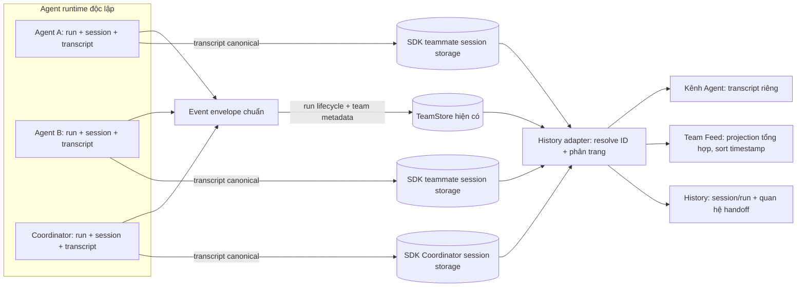

# Đề xuất sửa lịch sử Agent và Team Feed — v0.1.1

> **Trạng thái:** Gate quyết định Phase 0 đã ghi nhận; schema mapping participant, policy tiếp tục conversation và extension-side transcript query adapter có code/test. SDK teammate transcript persistence, durable run mapping và WebView history chưa triển khai.  
> **Phạm vi:** Lịch sử của từng Agent, Team Feed tổng hợp, lưu trữ và điều hướng phiên  
> **Nguyên tắc:** Các Agent gần như độc lập; lịch sử Agent là nguồn dữ liệu riêng, Team Feed là góc nhìn tổng hợp.

## 1. Triệu chứng

- Khi Agent chạy, `#team-feed` vẫn thấy các dòng gọi tool/kết quả như `read_files`.
- Mở kênh riêng của Agent lại không thấy lịch sử tương ứng hoặc kênh trống.
- Timeline hiện tại chưa phải lịch sử bền vững: buffer card bị giới hạn, timestamp gán lúc render và các Agent ghép theo thứ tự card, không theo thời gian thật.

## 2. Nguyên nhân từ luồng hiện tại

Hai màn hình đang đọc hai nguồn khác nhau:

```mermaid
flowchart LR
  R[Team runtime events] --> W[WarRoomTracker]
  W -->|card buffer, tối đa 20 dòng| S[subscribeWarRoom]
  S --> F[TeamFeedView: gom buffer các Agent]
  E[teammate SDK event] --> T[message-translator / task transcript]
  T -->|ClineMessage có agentId| M[Task Cline đang active]
  M --> P[ChatView: lọc selectedAgentId]
  R[Team runtime SessionRuntime riêng mỗi teammate] -->|TeamEvent: agentId + event| W
  R -->|conversationId + transcript chỉ trong ConversationStore| RS[Runtime memory; chưa được persist]
  H[History: taskId + agentTasks map] -->|chọn task| A[switchAgentInActiveTab]
  A -->|agentTasks[agentId] thiếu => taskId undefined| M
```

Các điểm xác nhận trong code:

1. `sdk/packages/core/src/extensions/tools/team/multi-agent.ts` tạo `SessionRuntime` riêng cho từng teammate, bọc event với `agentId`; TeammateSpawned công bố `runtimeAgentId` và `conversationId`, còn `team_run_task` tạo `runId` (`run_...`) và event run mang `taskId` tùy chọn. Vì vậy “Agent gần như độc lập” phù hợp với runtime: mỗi Agent có luồng/session riêng; quan hệ với Team là metadata/handoff, không phải một transcript chung.
2. `src/orvanta/war-room-tracker.ts` giữ card buffer trong bộ nhớ (20 dòng) và transcript tracker riêng (tối đa 500 dòng); `RunStarted` xóa card buffer lần chạy trước. Tracker này không phải API lịch sử bền vững để query theo Agent/run sau khi khởi động lại.
3. `webview-ui/src/orvanta/TeamFeedView.tsx` tổng hợp `agent.buffer`. Mọi dòng trong một lần render nhận cùng `timeStr = now`; vòng lặp duyệt từng Agent chứ không sort theo timestamp event. `OrvantaCardBufferLine` hiện chỉ có `kind` và `text`, nên UI không thể dựng thời gian/thứ tự chính xác.
4. Teammate runtime phát `TeamEvent.AgentEvent` riêng qua callback `onTeamEvent`; callback của extension hiện đưa event vào `globalWarRoomTracker`. `sdk/packages/core/src/extensions/tools/team/persistence-policy.ts` phân loại `AgentEvent` là telemetry và loại khỏi durable team event log. Dù comment trong policy nói transcript đầy đủ đã nằm trong session storage teammate, đường thực thi Agent Teams hiện **không persist transcript đó**: `AgentTeamsRuntime.spawnTeammate()` chỉ tạo `SessionRuntime`; transcript thuộc `ConversationStore` trong RAM. `runtime-builder.ts`/`TeamPersistenceWriter` lưu team state, run lifecycle/metadata và kết quả rút gọn, không lưu messages của teammate. Nhánh `sdk-session-event-coordinator.ts`/`message-translator.ts` của UI chính append/save `ClineMessage` theo task đang active, không thể thay thế phần persistence bị thiếu.
5. Kênh Agent đi qua `ChatView` → `filterMessagesForAgentChannel(...)`, lọc transcript task theo `agentId`. Nó không đọc tracker transcript hoặc trực tiếp `SessionRuntime` theo `conversationId`/`runId`; hiện chưa có luồng tải chat lịch sử từ runtime Agent riêng vào kênh.
6. `webview-ui/src/orvanta/tabs/useChatTabs.ts`: `switchAgentInActiveTab` lấy task bằng `currentTab.agentTasks?.[newAgentId]` rồi chuyển backend sang task đó. Nếu map thiếu task cho Agent, task active thành `undefined`; timeline vẫn có dữ liệu nhưng ChatView không có transcript để render.
7. Có ba lớp persistence khác phạm vi: SDK session storage/`ClineCore.readMessages(sessionId)` (chỉ hoạt động với session thực sự được host persist), TeamStore cho team state/durable events (không chứa streaming `AgentEvent`), và Orvanta `session-history-store.ts` cho manifest/index cùng participant/task metadata. Agent Teams hiện không tạo/persist child SDK session tương ứng; vì vậy `runtimeAgentId`, `conversationId`, `runId` và Orvanta `taskId` **chưa map được** thành một SDK `sessionId` có thể đọc lại. Schema/binding không đồng nghĩa có transcript hoặc API nối chúng tới UI. Không dùng `readMessages` trước khi SDK persist teammate session thật.
8. Metadata `agentTasks` trong history là map để mở đúng task; nó không tự nạp `conversationId`/run transcript từ Team runtime.

**Kết luận:** Đây là lỗi **nối luồng/runtime data với kênh Agent và history UI**, không phải CSS, Virtuoso hay cuộn. Global feed đọc `TeamEvent` từ tracker; kênh Agent đọc `ClineMessage` của task đang active; Agent Teams có `ConversationStore` riêng trong RAM nhưng đường hiện tại chưa persist messages vào SDK session storage. `ClineCore.readMessages(sessionId)` là API đọc thật, song chưa có SDK teammate `sessionId` tương ứng được tạo/lưu. Nếu `agentTasks[agentId]` thiếu thì chuyển Agent làm task active thành `undefined`; timestamp global feed vẫn là thời điểm render, không phải event time. Do đó prerequisite implementation là bổ sung persistence và mapping ID ở SDK/host; UI adapter chỉ có thể triển khai sau khi transcript tồn tại bền vững.

## 3. Hướng xử lý đề xuất

### Mô hình dữ liệu

> **Trạng thái hiện tại:** sơ đồ dưới đây là target architecture. Agent Teams chưa tạo SDK teammate sessions; không hiểu các mũi tên SDK1/SDK2 là persistence đã hoạt động.

Dùng event envelope thống nhất cho mọi hoạt động, có thể bổ sung vào event/session store hiện tại sau khi kiểm tra khả năng sử dụng lại schema session-history (không mặc định tạo kho thứ hai):

```text
Event {
  eventId, companyId, agentId, runId, parentRunId?, taskId?,
  timestamp, sequence, kind, payload
}
```

- **Một nguồn transcript bền vững (target):** khi teammate SDK sessions được triển khai, dùng SDK session messages artifact làm transcript canonical; Orvanta session manifest giữ participant ↔ SDK session ↔ Orvanta task/run mapping. TeamStore/run records chỉ là metadata/lifecycle, không phải transcript. Hiện teammate Agent Teams transcript chỉ ở `ConversationStore` RAM; vì thế chưa được tuyên bố là persist.
- **Độc lập:** lịch sử, trạng thái, lỗi, token, kết quả của Agent A không phụ thuộc Agent B hoặc Coordinator đang mở tab nào. Handoff tạo event tham chiếu (`parentRunId`/đích nhận), không trộn transcript.
- **Tương thích:** đọc session/message cũ như nguồn legacy; không xóa hoặc tự ý di chuyển dữ liệu. Khi thiếu metadata, đánh dấu “lịch sử cũ/chưa liên kết Agent”.

### Sơ đồ kiến trúc đề xuất



### Bố cục lịch sử/UI

```text
┌ #team-feed · Hoạt động toàn đội ────── đang chạy: 2 ┐
│ [Bộ lọc: Tất cả | Agent | Trạng thái | Khoảng giờ]  │
├───────────────┬─────────────────────────────────────┤
│ 10:52:58      │ Coordinator  Giao task task_0001    │
│ 10:53:02      │ Implementer   Bắt đầu run · task...  │
│ 10:53:04      │ Implementer   read_files · thành công│
│ 10:53:10      │ Reviewer      Bắt đầu run · task...  │
└───────────────┴─────────────────────────────────────┘

┌ @Implementer · run/task riêng ──────── Đang chạy ┐
│ Tóm tắt run | trạng thái | thời lượng | token      │
│ Transcript riêng theo thời gian thật               │
│ Tool / reasoning / output thu gọn, tìm kiếm        │
└────────────────────────────────────────────────────┘
```

- Click event trong Team Feed mở đúng Agent và đúng `runId`/`taskId`.
- Kênh riêng mặc định hiện lịch sử Agent đang chọn; handoff/trao đổi Coordinator là thẻ liên kết, không lẫn output Agent khác.
- Tách “live activity” (snapshot ngắn, nhẹ) khỏi “history” (đọc phân trang từ store); không dùng buffer 20 dòng làm kho lịch sử.

## 4. Checklist triển khai chi tiết

### Quy ước định danh và dữ liệu

- [x] Giữ riêng biệt các ID và ghi rõ vai trò trong type/comment/API:
  - `agentId`: slug ổn định của Agent trong roster (ví dụ `reviewer`); khóa dùng để phân loại participant.
  - `runtimeAgentId`: ID runtime của `SessionRuntime`; phục vụ telemetry/runtime, không dùng làm SDK session ID.
  - `conversationId`: ID transcript trong `ConversationStore`; không tự đồng nghĩa với session được lưu bền vững.
  - `sdkSessionId`: ID mà SDK host dùng cho `readMessages`/`readDisplayMessages`.
  - `runId`: ID một lần giao việc; một Agent có thể có nhiều run trong session.
  - Orvanta `sessionId` / participant `taskId`: định danh history hiện có; không ghi đè bằng các ID SDK.
- [x] Chốt cardinality trước khi sửa schema: một participant/Agent có một SDK transcript/session canonical nối tiếp qua nhiều lần run; các run được giữ như nhiều tham chiếu `runId` trên cùng participant. Mỗi participant vẫn giữ Orvanta `taskId` riêng; không tạo SDK session cho từng run ở bước này.
- [x] Chọn Orvanta session manifest hiện có làm nơi canonical để lưu mapping participant → runtime/conversation/SDK session và các `runId`; không thêm index/version riêng vì index đang là summary, còn lookup theo session/participant dùng manifest.

### Phase 0 — Contract và quyết định persistence (gate)

- [x] Ghi contract/thiết kế cho session teammate: `sdkSessionId` phải do SDK host cấp qua `StartSessionInput.config.sessionId` (hoặc host tạo bằng `createSessionId()`); không do Agent runtime, run hay Orvanta history tự suy ra. Thiết kế yêu cầu tạo SDK session row/manifest/messages artifact ở `RuntimeHost.startSession` trước run đầu, dùng `parentSessionId =` SDK session của Coordinator, `parentAgentId =` roster `agentId`, `agentId =` roster slug, `conversationId =` runtime conversation ID. Metadata cần giữ gồm Orvanta `sessionId`/participant `taskId` (nếu có), SDK `parentSessionId`, roster `agentId`, runtime/conversation IDs, team identity và run links. Reopen theo stored `sdkSessionId`; hydrate từ `readMessages`, rồi gọi `continue()` để giữ transcript. **Đây là contract mục tiêu, chưa phải persistence đã triển khai.**
- [x] Trace API và persistence: `AgentConfig.sessionId` là SDK/core host lifecycle ID theo `sdk/packages/shared/src/agents/types.ts`; `CreateAgentRuntimeConfigInput.sessionId` chuyển ID đó tới Agent runtime nhưng bản thân `SessionRuntime` tạo trực tiếp không tự đăng ký persistence. Đường chuẩn là `RuntimeHost.startSession` → `ensureSessionsDir` + session manifest/row/messages artifact → host agent hooks `persistSessionMessages` ở ranh giới assistant turn / abort. `ClineCore.readMessages(sdkSessionId)` trả canonical model/replay history; `readDisplayMessages` chỉ project cùng messages cho UI. `SessionManifestStore.persistSessionMessages` là nơi ghi messages artifact. `AgentTeamsRuntime.spawnTeammate()` hiện chỉ gọi `new SessionRuntime(wrappedConfig)`; không gọi `startSession`, không tạo child SDK row/artifact và `TeamPersistenceWriter` không persist `AgentEvent` transcript. `TeamChildSessionManager` có writer/reader child-session riêng cho flow team-task khác, không được nối vào Agent Teams teammate runtime.
- [x] Quyết định dữ liệu cũ: participant/Agent thiếu `sdkSessionId` hiển thị trạng thái `unlinked`/empty có giải thích; không dò theo tên, `conversationId`, timestamp, `runId`, task ID hoặc session ID gần giống. Chỉ mapping được ghi rõ mới cho phép đọc; `not-found`/corrupt SDK session hiển thị unavailable, không fallback sang transcript Agent khác hoặc root task.
- [x] Chốt semantics run/Team Feed: một SDK transcript/session nối tiếp cho mỗi roster participant trong một Orvanta session; từng `runId` liên kết về cùng session, transcript không split/copy. Team Feed là projection sắp theo durable lifecycle event timestamps/sequence và dùng runId để gắn hoạt động tới đúng Agent/run; message transcript lấy từ SDK session. Sau run khởi tạo, mọi run/retry/recovered run của participant phải tiếp tục transcript này (kể cả khi caller hiện truyền `continueConversation=false`); tùy chọn đó không được phép âm thầm xóa canonical history. Code hiện ép các run tiếp theo trong cùng runtime đi qua `continue()` (`multi-agent.ts`; có lifecycle test). Việc persist/reopen session sau restart vẫn chưa triển khai.
- [x] Cập nhật persistence policy/comment: `persistence-policy.ts` và `multi-agent.ts` giờ ghi rõ run summary không phải persisted transcript và teammate Agent Teams hiện chỉ giữ transcript trong memory.

#### Contract ID / cardinality

```text
Orvanta sessionId (history) ──participant.taskId (Orvanta task)
          │                             │
          └─ participant.transcript ────┴─ agentId (roster slug)
                           ├─ sdkSessionId (SDK host read/write key)
                           ├─ runtimeAgentId (SessionRuntime identity; telemetry only)
                           ├─ conversationId (ConversationStore transcript identity)
                           └─ runIds[] ── runId (TeamStore lifecycle references)
```

`sdkSessionId` được lưu cùng mapping trong Orvanta session manifest; SDK session messages artifact là nguồn transcript duy nhất. Không đổi tên hoặc ghi đè Orvanta `sessionId`/participant `taskId` bằng SDK IDs. Một participant có một SDK transcript; nhiều runs tham chiếu transcript đó.

**Gate 0 — hoàn tất:** contract/cardinality, ID map, SDK create/write/read path, legacy behavior và correction persistence claims đã được ghi nhận. **Giới hạn:** implementation chưa thỏa contract: Agent Teams chưa tạo SDK sessions; trước khi Phase 1 xong transcript vẫn memory-only.

### Phase 1 — Persist transcript teammate trong SDK (nền tảng)

- [ ] Mở rộng lớp tạo teammate để nhận session identity/mapping được host cấp; không tự suy diễn `sdkSessionId` từ `runtimeAgentId`, `conversationId`, `runId` hoặc Orvanta `taskId`.
- [ ] Nối lifecycle của teammate vào SDK session persistence: tạo/khởi tạo row và message artifact theo conventions của core; persist các message mới sau run/turn và trên các kết thúc/error/cancel phù hợp.
- [ ] Bảo đảm write không block hoặc làm hỏng run nếu storage lỗi; log/telemetry đủ ngữ cảnh, truyền trạng thái persistence lỗi cho caller để UI không báo “lịch sử đã lưu” sai.
- [ ] Hỗ trợ restart/resume theo contract đã chốt: khôi phục đúng transcript, không tạo session trùng, không mất message cuối do shutdown/crash trong giới hạn đảm bảo đã định nghĩa.
- [ ] Kiểm tra bảo toàn metadata/message format cần thiết cho API SDK đọc; display projection là projection, không thay đổi canonical model transcript.
- [ ] Bổ sung unit tests cho tạo session, persist nhiều lượt, hai Agent độc lập, session mapping lặp lại/idempotency, không có mapping, lỗi ghi, shutdown/cancel và đọc lại bằng SDK API.

**Checkpoint 1:** các test persistence core pass; transcript của hai teammate đọc lại được bằng đúng `sdkSessionId`; TeamStore vẫn không chứa bản copy transcript.

### Phase 2 — Mapping participant/run và query adapter

- [x] Thêm binding metadata vào Orvanta participant manifest cho `agentSlugAtJoin` và transcript identity tùy chọn (`sdkSessionId`, runtime/conversation IDs, `runIds`); trường transcript tùy chọn giữ được participant cũ chưa liên kết. Store test xác nhận upsert/merge và đọc lại mapping. **Giới hạn:** chưa được nối vào quá trình teammate SDK session creation hoặc Team run event persistence.
- [ ] Ghi nhận quan hệ run với participant/session khi TeamStore phát durable run events; bảo đảm run ID không bị dùng làm session ID và transcript dùng chung nhiều run vẫn truy vấn đúng.
- [x] Thêm query adapter phía extension nhận Orvanta session + participant/run và truy xuất projection từ canonical SDK `readMessages`; validate Orvanta session/run/participant IDs, xác nhận SDK session thuộc đúng workspace, và phân biệt `not-linked`, `not-found`, `WORKSPACE_MISMATCH` cùng lỗi storage. Adapter chỉ dùng `sdkSessionId` được participant mapping tường minh cung cấp; không fallback sang task/session đang active hoặc Agent khác. **Giới hạn:** adapter chưa được nối vào RPC/UI; teammate SDK persistence chưa triển khai nên transcript có thể chưa tồn tại.
- [x] Thêm offset cursor trên display projection và giới hạn projection tối đa 2.000 canonical messages, tối đa 100 display rows/trang (mặc định 50); trả `truncated` và `readCost`. **Giới hạn:** SDK `readMessages` materialize toàn transcript trước khi cap/page; cursor không giảm I/O/memory đọc canonical store và không phải pagination native.
- [ ] Tạo projection dùng chung cho Agent channel và Team Feed: transcript messages lấy từ SDK, lifecycle/activity/timestamp lấy từ TeamStore; không trộn nội dung của Agents khác.
- [ ] Thêm tests mapping TeamStore durable run event/replay, run interrupted và corrupted on-disk SDK transcript khi mapping nhiều Agent, nhiều run cùng Agent, participant/session không tồn tại, participant cũ thiếu mapping và workspace mismatch. **Đã có:** query unit tests cho hai Agent, nhiều run chung mapping, participant/session không tồn tại, legacy unlinked, run không map, invalid IDs/cursor, storage read error, workspace mismatch và projection pagination. Chưa có TeamStore event-ingestion/replay test hoặc SDK storage integration fixture.

**Checkpoint 2:** chưa đạt. Query adapter tra mapping participant/run đúng và không fallback; nhưng durable TeamStore run→participant association, persisted teammate SDK sessions, run interruption/corrupt store integration tests và UI projection chưa được triển khai/xác minh. Teammate transcript khi restart chưa được bảo đảm.

### Phase 3 — Message contract và WebView wiring

- [ ] Chốt RPC/protobuf hoặc message contract hiện có để request lịch sử theo session/participant/run và trả trang messages + cursor + trạng thái liên kết; chỉ sửa proto nếu chưa có contract tái sử dụng.
- [x] Không thay proto trong phần việc đã kiểm tra; `bun --cwd apps/vscode check-types` chạy codegen thành công và không để lại generated diff. Nếu sau này có thay proto, chạy `bun run protos` từ `D:\orvanta\apps\vscode`; không sửa file generated thủ công.
- [ ] Thêm handler trong controller/adaptor và webview client; xử lý unsubscribe/cancel request khi đổi tab/Agent để response cũ không ghi đè lựa chọn mới.
- [ ] Sửa `agentTasks`/tab switching: mapping thiếu không được set task active thành `undefined` mà không thông báo; giữ đúng tab, participant và run khi chuyển qua lại.
- [ ] Thêm loading, empty/unlinked, unavailable/error và retry states; không biểu diễn lỗi tải như Agent chưa từng có history.
- [ ] Thêm tests handler/client/state race: đổi Agent nhanh, response đến muộn, tab đóng, refresh và participant không có session.

**Checkpoint 3:** webview mở được transcript một Agent qua API, chuyển Agent không lẫn dữ liệu và empty/error states phân biệt được.

### Phase 4 — Agent channel và Team Feed

- [ ] Kênh riêng hiển thị transcript đầy đủ của Agent đã chọn, phân biệt rõ các run nếu UX chọn run-level; giữ riêng Coordinator/handoff dưới dạng link/card tham chiếu.
- [ ] Team Feed tổng hợp các lifecycle/activity event có nguồn bền vững; mọi item dùng timestamp từ event/store thật, không gán `now` tại render.
- [ ] Sort ổn định theo timestamp và tie-breaker sequence/event ID; xử lý event trùng, đến muộn và timestamp không hợp lệ mà không làm đảo thứ tự tùy render.
- [ ] Không tuyên bố `AgentEvent` streaming đã phục hồi sau restart: nếu activity streaming cần durable, mở task riêng để persist event projection có version, timestamp/sequence, retention và dedup; không ghi transcript lần hai.
- [ ] Phân trang/virtualize lịch sử dài; giữ scroll position khi tải trang cũ; chỉ auto-scroll khi người dùng đang ở cuối.
- [ ] Click item Team Feed mở đúng Agent và đúng run/session; nếu mapping không tồn tại, hiển thị trạng thái không liên kết thay vì mở nhầm chat.
- [ ] Bổ sung UI tests cho timestamps/order, nhiều Agent, pagination, scroll behavior, stale responses, missing session và link đúng run.

**Checkpoint 4:** chức năng end-to-end hoạt động với ít nhất hai Agent đồng thời; feed chung có thứ tự ổn định; channel riêng không hiển thị chéo transcript.

### Phase 5 — Tương thích, độ bền và phát hành

- [ ] Kiểm thử restart extension/webview và khôi phục session: transcript đã persist vẫn đọc đúng; session đang chạy khi shutdown được đánh dấu theo semantics đã chốt.
- [ ] Kiểm thử dữ liệu cũ: participant/session không có mapping được đánh dấu rõ; dữ liệu hiện có không bị xóa/di chuyển tự động.
- [ ] Kiểm thử lỗi storage/permission/corruption, session not found, workspace khác, transcript lớn, duplicate/late events và hai Agent chạy song song.
- [ ] Kiểm tra privacy/security: chỉ đọc session thuộc workspace/team hiện tại; không đưa transcript/tool payload vượt quyền vào Team Feed tổng hợp.
- [ ] Chạy test đơn vị liên quan ở extension adapter/controller và webview; chạy typecheck/build theo scripts của các package này. (Chưa có luồng history adapter/controller/WebView để kiểm thử.)
- [x] Chạy test đơn vị hiện có ở SDK core và shared history store; chạy typecheck/build theo scripts của các package đã sửa.
- [x] Chạy `git diff --check`; kiểm tra codegen/generated files không tạo thay đổi ngoài ý muốn và không có proto diff.
- [x] Rà soát diff hiện tại: không phát hiện credential/data nhạy cảm bị thêm vào log; các thay đổi history chỉ thêm mapping metadata vào manifest hiện có, không thêm transcript store thứ hai. (Đây không thay thế kiểm tra privacy end-to-end ở mục trên.)
- [ ] Cập nhật tài liệu: kiến trúc thật sau triển khai, ID mapping, pagination/retention limits, legacy behavior, lệnh verify và các giới hạn chưa giải quyết.

**Definition of Done:** tất cả tiêu chí nghiệm thu ở mục 6 đạt; test hồi quy Agent A/B và restart pass; lỗi/missing history thể hiện minh bạch; không có fallback sang transcript sai; không phát sinh kho transcript trùng lặp.

## 5. Hướng đã xác nhận và giới hạn hiện tại

**Hướng được xác nhận:** mỗi Agent có một transcript riêng; các run của Agent liên kết về transcript đó. Team Feed là projection tổng hợp từ transcript SDK và lifecycle events, không phải transcript store thứ hai.

> **Giới hạn chẩn đoán đã cập nhật:** Hai luồng UI khác nhau, task mapping có thể thiếu, timestamp dựng tại render, Agent runtime riêng và `AgentEvent` telemetry không lưu vào TeamStore đã được xác nhận. SDK có API đọc messages bằng SDK `sessionId`, nhưng Agent Teams teammate hiện chưa được persist thành SDK session; policy comment nói transcript đã được lưu là không chính xác với đường code này. Trước khi WebView adapter có thể nối participant/history, cần quyết định và triển khai cách teammate có session ID bền vững + persist transcript vào SDK session storage. Không tạo kho transcript thứ hai.

## 6. Tiêu chí nghiệm thu

- Agent A và B chạy đồng thời; kênh riêng chỉ hiện transcript thuộc Agent đó, không phụ thuộc trạng thái hoặc thứ tự chọn Agent.
- Timeline chung hiển thị timestamp/sequence event thật và thứ tự toàn cục chính xác; không đóng dấu tất cả dòng bằng thời điểm render.
- Chuyển tab, refresh WebView hoặc khởi động lại Extension không làm mất transcript đã lưu; click event mở đúng Agent/run.
- Live feed nhẹ; lịch sử dài dùng phân trang/virtualization, không đẩy toàn bộ transcript mỗi event.
- Session cũ vẫn mở được hoặc được đánh dấu rõ khi không có liên kết Agent/run.

---

**Phiên bản tài liệu:** 0.1.1  
**Ngày:** 2026-10-30
